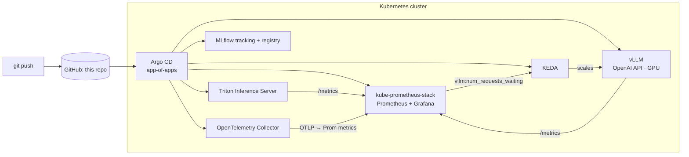

# Sunn Platform Lab

> A hands-on, GitOps-driven lab for running AI workloads in production on Kubernetes:
> **GitOps → model serving → GPU scheduling → AI observability → AI autoscaling.**

The modern DevOps stack isn't just `Docker → Kubernetes → CI/CD` anymore. This repo is two things:

1. **A curated list** of the open-source projects that sit where DevOps, MLOps, AI infra and observability meet.
2. **A working platform** you can stand up yourself: Argo CD deploys everything from this repo (app-of-apps), vLLM and Triton serve models, KEDA scales them on real inference metrics, and Prometheus / Grafana / OpenTelemetry watch it all.

---

## The curated list

| Category | Project | What it does | Lab |
|---|---|---|---|
| GitOps / Platform | [Argo CD](https://github.com/argoproj/argo-cd) | Declarative GitOps continuous delivery for Kubernetes. Keeps cluster state synced with Git. | [01](labs/01-argocd) |
| GitOps / Platform | [KEDA](https://github.com/kedacore/keda) | Event-driven autoscaling: scale pods on queue length, metrics or external events (incl. scale-to-zero). | [02](labs/02-keda) |
| MLOps | [Kubeflow](https://github.com/kubeflow/kubeflow) | End-to-end ML platform on Kubernetes: pipelines, training operators, notebooks, serving. | [03](labs/03-kubeflow) |
| MLOps | [MLflow](https://github.com/mlflow/mlflow) | ML lifecycle: experiment tracking, model registry, deployment workflows. | [04](labs/04-mlflow) |
| Observability | [Prometheus](https://github.com/prometheus/prometheus) | Metrics and alerting for distributed systems. | [05](labs/05-prometheus-grafana) |
| Observability | [Grafana](https://github.com/grafana/grafana) | Dashboards for metrics, logs and traces. | [05](labs/05-prometheus-grafana) |
| Observability | [OpenTelemetry](https://github.com/open-telemetry/opentelemetry-collector) | Vendor-neutral telemetry pipeline for logs, metrics and traces. | [06](labs/06-opentelemetry) |
| LLM inference | [vLLM](https://github.com/vllm-project/vllm) | High-throughput LLM inference engine with an OpenAI-compatible API (PagedAttention, continuous batching). | [07](labs/07-vllm) |
| LLM inference | [NVIDIA Triton](https://github.com/triton-inference-server/server) | Multi-framework model serving (ONNX, PyTorch, TensorRT, Python, vLLM backends). | [08](labs/08-triton) |
| LLM inference | [NVIDIA Dynamo](https://github.com/ai-dynamo/dynamo) | Distributed inference framework: disaggregated prefill/decode, KV-cache-aware routing. | [09](labs/09-dynamo) |

---

## Architecture



More detail in [docs/architecture.md](docs/architecture.md).

## What's inside

| Area | What | Tested by |
|---|---|---|
| **GitOps platform** | Argo CD app-of-apps → Prometheus/Grafana, KEDA, OTel, MLflow, vLLM, Triton, gateway, SLO rules | kubeconform, Conftest |
| **Terraform** ([`terraform/`](terraform)) | dev/staging/prod on AWS: VPC, EKS + GPU pool, service catalog with least-privilege Pod Identity | `terraform test` (mocked AWS), tflint, checkov |
| **SRE** ([`sre/`](sre)) | SLOs, multi-window burn-rate alerts, runbooks, error-budget policy, chaos lab, postmortem/ADR/design templates | `promtool test rules`, drift check |
| **DevSecOps** ([`SECURITY.md`](SECURITY.md)) | gitleaks, CodeQL, Trivy (image/IaC/deps), SBOM, cosign keyless signing, Dependabot, OPA policies, hardened manifests | CI gates |
| **Service** ([`services/inference-gateway`](services/inference-gateway)) | Auth, rate limiting, input caps, SLI metrics in front of vLLM | pytest (90% coverage gate), ruff |
| **Network-as-code** ([`network/`](network)) | Spine-leaf eBGP fabric → Arista EOS + Junos configs, RoCEv2 lossless profile on GPU leaves | pytest unit + golden-config tests |
| **Ansible** ([`ansible/`](ansible)) | On-prem GPU node prep (driver, container toolkit, sysctls) + fabric deploy with commit-confirmed | ansible-lint (production profile) |
| **Study** ([`study/`](study)) | 8-week plan mapped to my background, 13 graded exercises, system-design and question bank | n/a |

Run every suite: `make test` · end-to-end on kind: `make e2e` · exercise status: `make exercises`.

**CI/CD** ([docs/ci-cd.md](docs/ci-cd.md)): every PR runs static validation, unit tests, policy and security scans; a **nightly e2e** stands the platform up on kind and runs 12 smoke tests; exercise branches (`ex/NN-*`) are graded automatically.

## Repo layout

```
terraform/          AWS foundation: VPC, EKS + GPU pool, per-service IAM/SQS/S3/RDS (dev/staging/prod)
gitops/             Argo CD app-of-apps (core + opt-in inference)
platform/           Helm values + Kustomize manifests the Applications point at
services/           application code (inference-gateway) with tests + secure Dockerfile
policy/             OPA/Rego policies for Kubernetes manifests + unit tests
sre/                SLO rules (source of truth), promtool tests, generator
docs/               architecture, ADRs, runbooks
templates/          postmortem, runbook, ADR, design-doc templates
network/            netgen: fabric YAML → multi-vendor switch configs
ansible/            GPU node role + network deploy playbooks
labs/NN-<tool>/     standalone, step-by-step lab per tool (incl. 10 chaos engineering)
study/              study plan, exercises, interview prep
bootstrap/, scripts/  kind cluster + Argo CD bootstrap, load generator
```

## Running on AWS

[`terraform/`](terraform) builds the cloud foundation: account-isolated dev/staging/prod, VPC, EKS with a scale-from-zero GPU node pool, and a service catalog that gives each microservice its own ECR repo, SQS queue, S3 bucket, secrets, Postgres and least-privilege Pod Identity role. See [terraform/README.md](terraform/README.md).

## Quickstart (local kind cluster)

**Prereqs:** `docker`, `kind`, `kubectl`, `helm`. GPU components (vLLM, Triton GPU) need a node with an NVIDIA GPU + the [NVIDIA GPU Operator](https://github.com/NVIDIA/gpu-operator) or device plugin — everything else runs on a laptop.

```bash
# 0. Point the Argo CD Applications at YOUR fork
make set-repo REPO=https://github.com/<you>/sunn-platform-lab.git

# 1. Local cluster (skip if you already have one)
make cluster

# 2. Install Argo CD and hand it the root app
make bootstrap

# 3. Watch it converge
kubectl -n argocd get applications -w

# 4. UIs
make argocd-ui     # https://localhost:8080  (user: admin, pw printed by `make argocd-password`)
make grafana-ui    # http://localhost:3000   (admin / prom-operator — change it)
make mlflow-ui     # http://localhost:5000
```

The core stack (GitOps, KEDA, observability, MLflow) runs on a laptop. When you have a GPU node, turn on inference:

```bash
make inference     # applies gitops/root-inference.yaml → vLLM (GPU) + Triton
make vllm-api      # http://localhost:8000/v1/chat/completions
```

## Pinned versions

| Component | Version | Where |
|---|---|---|
| Argo CD Helm chart | 10.17.0 | `bootstrap/install-argocd.sh` |
| kube-prometheus-stack chart | 93.0.0 | `gitops/apps/monitoring.yaml` |
| KEDA chart | 2.21.0 | `gitops/apps/keda.yaml` |
| opentelemetry-collector chart | 0.178.2 | `gitops/apps/otel-collector.yaml` |
| MLflow image | v3.18.0 | `platform/mlflow/deployment.yaml` |
| vLLM image | v0.33.0 | `platform/vllm/deployment.yaml` |
| Triton image | 26.08-py3 | `platform/triton/deployment.yaml` |

Renovate/Dependabot-style bumps are a great first PR.

## Roadmap

- [ ] GPU time-slicing / MIG profiles via GPU Operator
- [ ] DCGM exporter dashboards for GPU utilization & memory
- [ ] Kubeflow Pipelines → MLflow registry → Argo CD promotion flow
- [ ] Dynamo disaggregated serving on a multi-GPU node
- [ ] Tempo/Loki for traces & logs behind the OTel Collector
- [ ] More in [study/exercises](study/exercises): Karpenter, ApplicationSets, Kyverno verifyImages, EVPN-VXLAN, MIG

## License

MIT — see [LICENSE](LICENSE).
