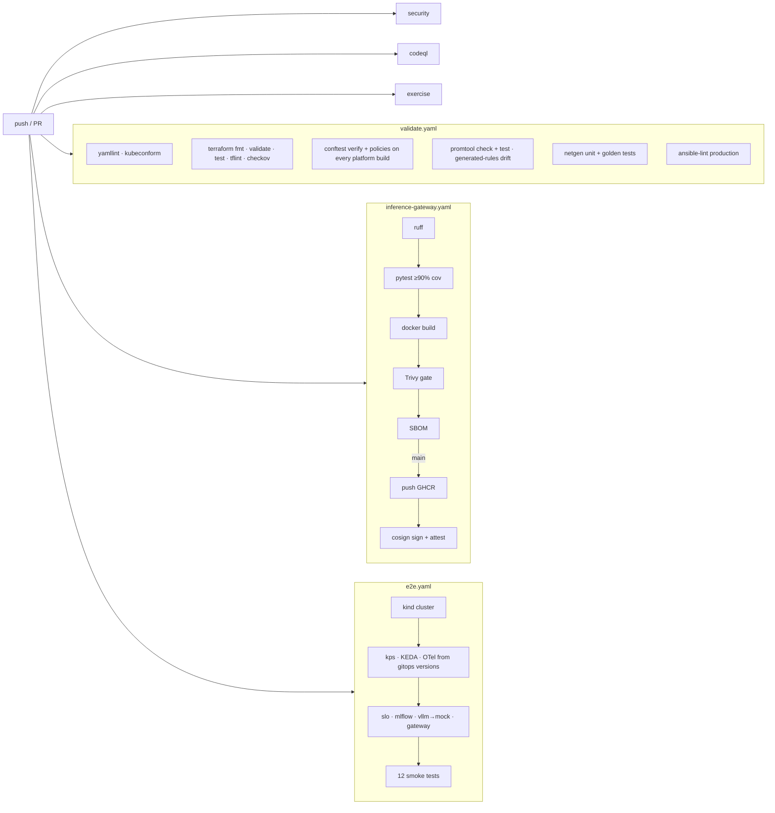

# CI/CD

Every change is proven by tests at the layer it touches, and again end-to-end on a real cluster.

| Workflow | Runs on | What it proves |
|---|---|---|
| `validate` | every push to main, every PR | Static correctness of everything: YAML, Kubernetes schemas, Terraform (incl. `terraform test` with mocked AWS), Rego unit tests + policies, SLO alert unit tests, network golden configs, Ansible |
| `inference-gateway` | changes under `services/inference-gateway` | Lint, unit tests with coverage gate, image builds, no fixable CRITICAL CVEs, SBOM. On main: push, keyless sign, SBOM attestation |
| `security` | every push/PR + weekly | No secrets in history, IaC misconfig report, no CRITICAL dependency CVEs |
| `codeql` | every push/PR + weekly | Python and GitHub Actions code scanning |
| `e2e` | PRs touching platform/gitops/services/sre/labs, main, **nightly**, on demand | The platform *works*: charts + values install, NetworkPolicy permits the right traffic, Prometheus scrapes, SLO rules evaluate on real traffic, KEDA scales on queue depth, labs 04 and 06 run for real |
| `exercise` | branches `ex/NN-*`, PRs, on demand | That exercise's acceptance criteria (strict). On other PRs: status board of all exercises |
| `terraform-plan` | PRs touching `terraform/` once AWS OIDC is set up | Real `terraform plan` per env × stack |

## The e2e smoke tests

| Test | Promise |
|---|---|
| `test_gateway_rejects_requests_without_api_key` | AuthN enforced in the deployed build |
| `test_gateway_proxies_to_model_server_through_networkpolicy` | NetworkPolicy allows gateway → vLLM + DNS |
| `test_gateway_maps_engine_failure_to_502` | Failure semantics the SLO depends on |
| `test_gateway_runs_as_non_root_with_read_only_fs` | Hardening survives to the cluster |
| `test_prometheus_scrapes_gateway_and_model_server` | ServiceMonitors + selector config work |
| `test_sli_metrics_reach_prometheus` | SLIs exist with the 2.5s bucket |
| `test_slo_rules_are_loaded_and_evaluating` | `platform/slo` loads and sees injected 5xx |
| `test_vllm_dashboard_shipped_to_grafana` | Dashboard ConfigMap labelled for the sidecar |
| `test_keda_scaledobject_is_ready` | KEDA reaches Prometheus at `kps-prometheus` |
| `test_keda_scales_vllm_when_queue_backs_up` | **The real `platform/vllm/scaledobject.yaml` scales on `vllm:num_requests_waiting`** |
| `test_lab04_mlflow_train_and_register` | Lab 04 runs against the deployed MLflow (3.x host checks included) |
| `test_lab06_otel_metrics_flow_to_prometheus` | Lab 06: OTLP → collector → Prometheus |

Run locally: `make e2e` (or `KEEP_CLUSTER=true make e2e` to keep the cluster for debugging).

## Recommended branch protection for `main`

Settings → Branches → Add rule for `main`:
- Require a pull request before merging (1 approval, or 0 if you're solo, plus "Require review from Code Owners")
- Require status checks: `validate`, `terraform`, `policy-as-code (OPA / Conftest)`, `SLO rules (promtool) + generated output drift`, `network-as-code (netgen unit + golden tests)`, `ansible-lint (production profile)`, `test`, `image`, `secret scan (gitleaks, full history)`, `analyze (python)`, `platform on kind`, `acceptance checks`
- Require branches to be up to date before merging
